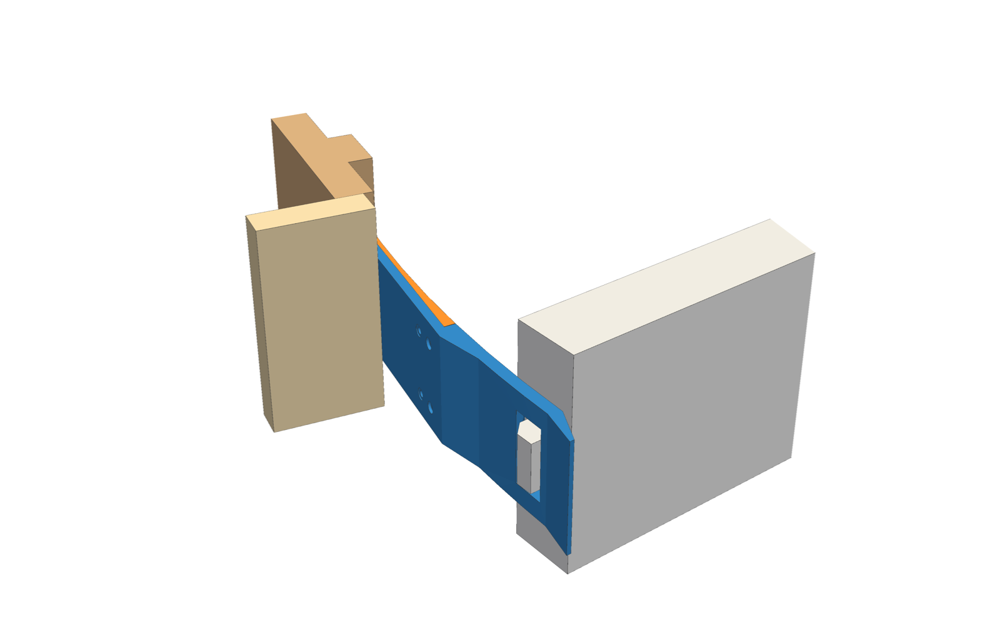
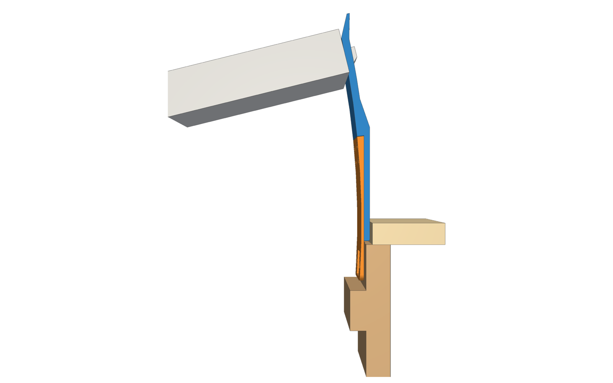
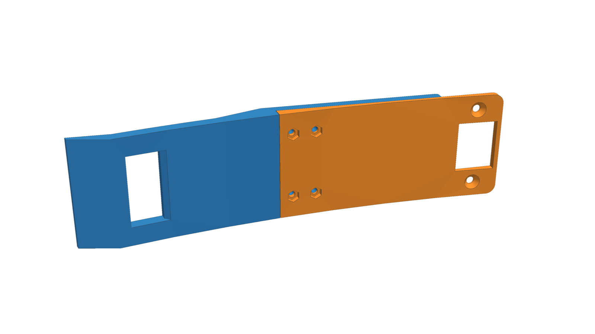
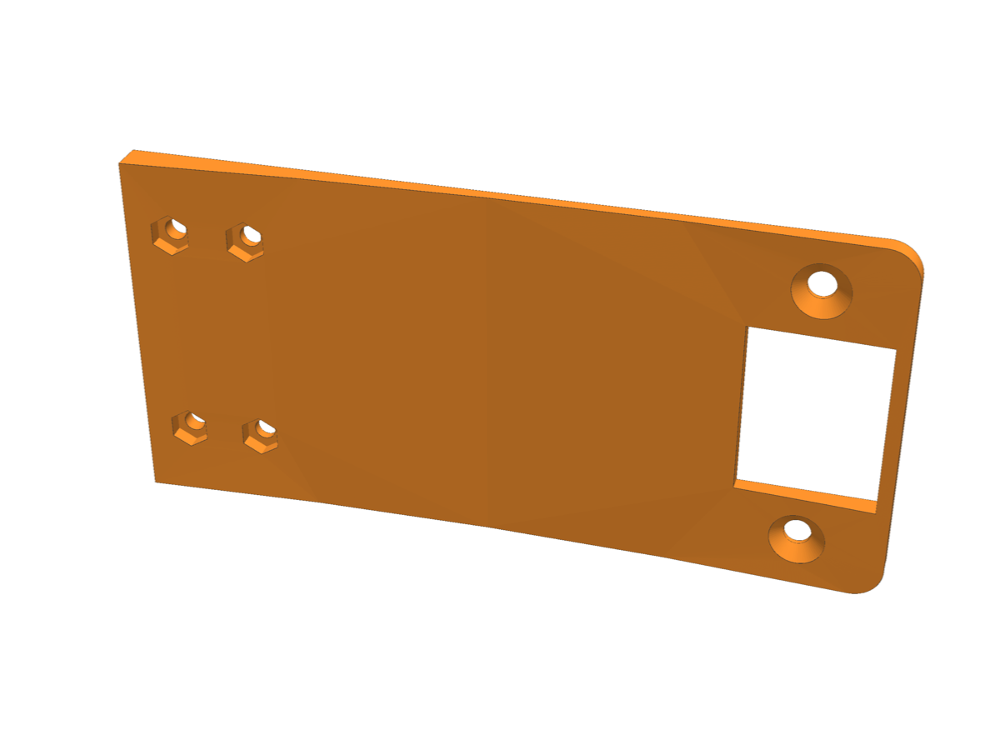
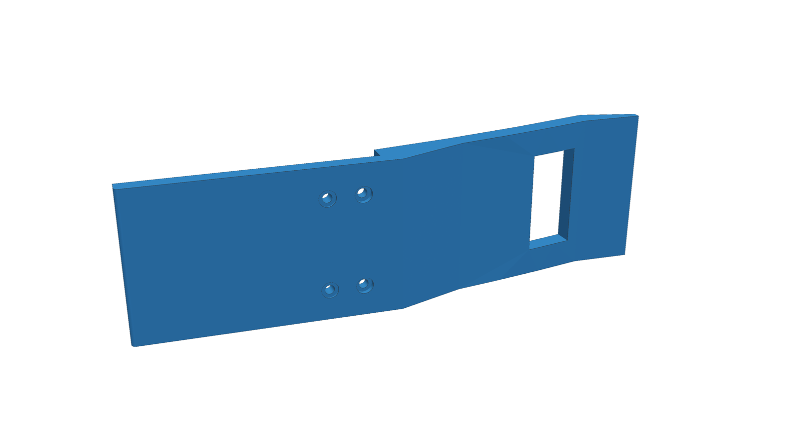

# Curved Cat Door Latch

A 3D printed door stop that holds an interior door open just wide enough for a cat to get through, and keeps it from closing or blowing open.

It replaces the door's metal strike plate. When the door is opened about 14°, the latch bolt drops into a slot in a curved arm and holds the door there. To close the door fully, turn the handle.



This is a parametric remix of [Cat Door Latch rev 2](https://www.printables.com/model/763947) on Printables (CC0). The remix makes these changes:

- **The arm follows the door's swing arc.** It is centered on the real hinge axis, so the door clears it by a constant 1 mm the whole way around.
- **Two printed parts.** A face plate screws into the old strike recess, and a separate latch arm bolts to it.
- **The arm is braced by the trim.** Its root slides into the gap between the door frame and the trim, which keeps it stiff.
- **The latch bolt rides up a ramp.** When the door closes from wide open, the arm's flared tip pushes the bolt in, so it doesn't jam.
- **Everything is driven by measurements.** All dimensions live in one dataclass in `cat_door_latch.py`, and the build re-runs clearance checks against a model of the door, jamb and trim.

| Plan view (door held at the slot) | Parts, door side |
|---|---|
|  |  |

| Face plate | Latch arm |
|---|---|
|  |  |

## Files

| File | |
|---|---|
| [`out/face_plate.stl`](out/face_plate.stl) / `.step` | Face plate |
| [`out/latch_arm.stl`](out/latch_arm.stl) / `.step` | Latch arm |
| `out/ref_*.step` | Reference door (at the slot), lock jamb and trim, for checking fit in CAD |
| `cat-door-latch.3mf` | Bambu Studio project (Bambu Lab A1) |
| `original/` | The original Printables files |

The STEP files import cleanly into Onshape, Fusion and FreeCAD.

## Hardware

- 2x wood screws: reuse the strike plate screws.
- 4x M3x8 socket head cap screws.
- 4x M3 hex nuts, standard 2.4 mm thick.

## Install

1. Remove the metal strike plate.
2. Press the four nuts into the hex pockets on the face plate's front (the door side).
3. Screw the face plate into the strike recess.
4. Slide the arm's root into the gap between the jamb and the trim.
5. Bolt the arm to the plate from the trim side. The screw heads sit just past the trim, where you can reach them. Snug only, since they thread into plastic.

## Printing

| Part | Orientation | Notes |
|---|---|---|
| Face plate | Flat on its back | The nut pockets face up, so no supports are needed. |
| Latch arm | Standing on its lower edge | Tall and narrow, so give it good bed adhesion. |

For the arm, use an outer brim of 10 to 15 mm with **brim-object gap set to 0**; at the default 0.1 mm the part can pull off the brim. Also set elephant foot compensation to 0, use a glue stick, and turn the part fan off for the first few layers.

## Make it fit your door

Every dimension is a field of the `P` dataclass at the top of `cat_door_latch.py`: door width and thickness, hinge pivot position, strike recess, latch bolt, trim and so on. Measure your door, edit the values, and rebuild:

```sh
uv run --with build123d python cat_door_latch.py                     # STEP + STL into out/, prints clearance checks
uv run --with build123d --with pyvista python tools/render.py        # README images
uv run --with build123d --with trimesh --with matplotlib --with scipy --with networkx python tools/preview.py  # quick out/preview.png
```

Every overlap the build prints should read `0.000`.

The measurement that matters most is the **hinge pivot**: the actual axis the door rotates around, not the edge of the hinge barrel. If it's wrong, the parts rub harder the farther the door opens.

See [NOTES.md](NOTES.md) for the coordinate frame, every measured value, design reasoning and lessons learned from test installs.

## License

[CC0 1.0](LICENSE), public domain, same as the original design.
